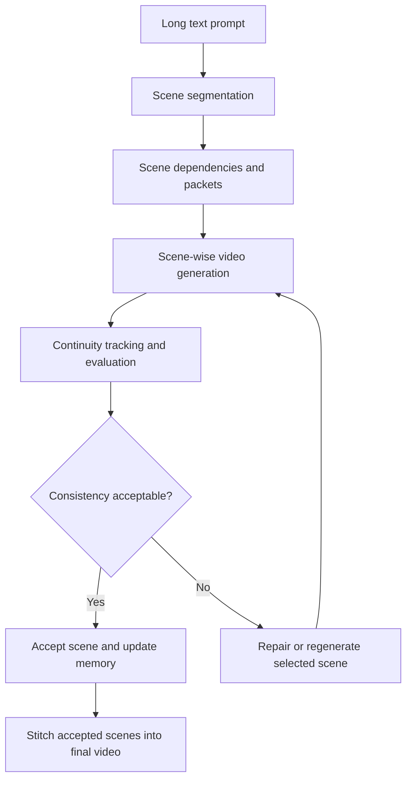
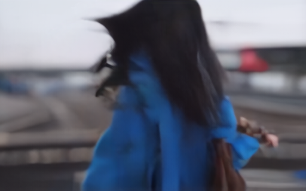
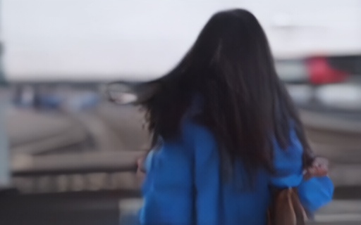
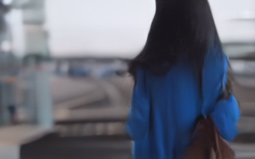
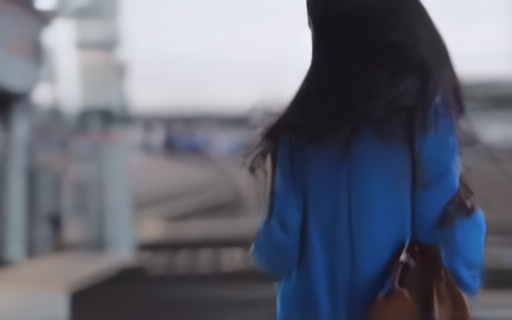
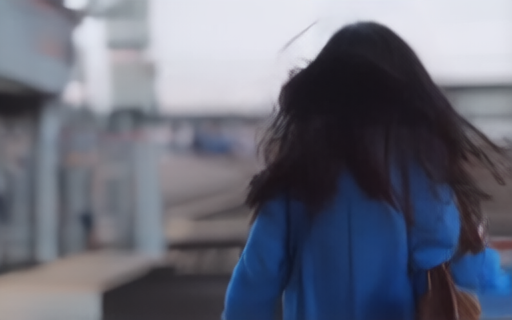

# Dependency-Aware Closed-Loop Long Text-to-Video Generation

**Persistent visual memory, scene dependencies, and selective scene repair**

This repository documents an experimental pipeline for generating multi-scene videos from long text prompts. It also accompanies the M.Tech dissertation **“Dependency-Aware Multi-Level Feature-Guided U-Net with Audit-Gated Causal Memory for Long Text-to-Video Generation” (DAMF-CMG)**, completed at the National Institute of Technology Sikkim in 2026.

> **Scope:** The repository contains a scene-wise video-generation prototype and related code/output artifacts. The dissertation describes a broader DAMF-CMG research framework, including proposed memory-conditioned denoising components. The existence of a design in the dissertation should not be interpreted as proof that every described component is fully trained or implemented in this repository.

## Overview

Many text-to-video models produce short clips, but a long narrative consists of connected scenes. Generating these scenes independently can cause character identity drift, inconsistent backgrounds, disappearing props, and weak transitions.

This project explores a **scene-wise generation pipeline** that segments a long prompt, represents relationships among scenes, carries forward continuity information, evaluates generated content, and uses repair logic to address selected failures.

## System workflow



The dissertation expands on this workflow with a **repair-aware dependency graph**, **audit-gated causal memory**, and a proposed **DAMF-U-Net** mechanism for conditioning denoising on relevant visual memories.

## Main ideas

- **Scene segmentation:** split a narrative prompt into manageable scene descriptions.
- **Scene dependencies:** track recurring characters, locations, props, actions, and transitions.
- **Scene-wise generation:** produce short clips and combine them into a longer sequence.
- **Continuity memory:** reuse relevant information or references from earlier scenes.
- **Consistency evaluation:** examine drift and continuity errors.
- **Selective repair:** focus correction on problematic scenes rather than always repeating the entire sequence.

**Research proposal vs. prototype:** DAMF-CMG's full trainable memory-conditioning architecture is described in the dissertation. Confirm the actual implementation and experimental evidence in the code and output artifacts before treating that architectural proposal as a validated result.

## Sample output: long text-to-video generation

**Input prompt**

> A young woman enters a railway station in the morning. She checks the departure board. A train arrives and she runs toward platform three. Inside the train, she sits by the window and opens an old letter.

### Final stitched video

Click the preview image to open the stitched video:

[](outputs/runs/run_long_20260318_220725/stitched_video/stitched_video.mp4)

[Watch the final stitched video](outputs/runs/run_long_20260318_220725/stitched_video/stitched_video.mp4)

### Scene-wise segmentation and frame outputs

The example long prompt is divided into four video segments. Each scene below shows its text description, a link to the generated clip, and the frame gallery retained from the original README.

#### Scene 01

**Segmented text:** A young woman enters a railway station in the morning.

[Watch Scene 01](outputs/runs/run_long_20260318_220725/generation/scene_001/attempt_00/scene_001.mp4)

**Generated frames:**

<p>
  
  
  
  
  
  
  
  
  
</p>

#### Scene 02

**Segmented text:** She checks the departure board.

[Watch Scene 02](outputs/runs/run_long_20260318_220725/generation/scene_002/attempt_00/scene_002.mp4)

**Generated frames:**

<p>
  
  
  
  
  
  
  
  
  
</p>

#### Scene 03

**Segmented text:** A train arrives and she runs toward platform three.

[Watch Scene 03](outputs/runs/run_long_20260318_220725/generation/scene_003/attempt_00/scene_003.mp4)

**Generated frames:**

<p>
  
  
  
  
  
  
  
  
  
</p>

#### Scene 04

**Segmented text:** Inside the train, she sits by the window and opens an old letter.

[Watch Scene 04](outputs/runs/run_long_20260318_220725/generation/scene_004/attempt_00/scene_004.mp4)

**Generated frames:**

<p>
  
  
  
  
  
  
  
  
  
</p>

> **Preview note:** Images are displayed from the files in `outputs/runs/`. If a preview does not appear on GitHub, check that its PNG exists in the remote repository at the exact linked path. The links and frames above are retained from the earlier README and have not been independently verified against the current remote repository.

## Repository structure

```text
.
├── configs/             # Configuration files
├── data/prompts/        # Example long-text prompts
├── outputs/runs/        # Generated scene and run artifacts
├── scripts/             # Pipeline entry points and utilities
├── src/                 # Core implementation modules
├── reports/             # M.Tech dissertation PDF
├── README.md            # Project overview and usage
└── requirements.txt     # Python package dependencies
```

## Getting started

Clone the repository and install the dependencies:

```bash
git clone https://github.com/9307632368/Dependency-Aware-Closed-Loop-Long-Text-to-Video-Generation-With-Persistent-Memory-Selective-Repair.git
cd Dependency-Aware-Closed-Loop-Long-Text-to-Video-Generation-With-Persistent-Memory-Selective-Repair
python -m pip install -r requirements.txt
```

The earlier README identifies the following entry point:

```bash
python -m src.main
```

**Before running:** check the configuration under `configs/`, available pretrained-model dependencies, GPU resources, and whether this entry point matches the current code. Requirements and hardware needs vary with the selected generation backend.

## Dissertation and technical documentation

**Title:** Dependency-Aware Multi-Level Feature-Guided U-Net with Audit-Gated Causal Memory for Long Text-to-Video Generation  
**Author:** Rohan Sanjay Pol  
**Program:** M.Tech in Artificial Intelligence and Machine Learning  
**Institute:** National Institute of Technology Sikkim  
**Year:** 2026

[Read the M.Tech dissertation (PDF)](reports/DAMF_CMG_MTech_Dissertation.pdf)

The dissertation discusses the proposed DAMF-CMG architecture, dependencies between scenes, audit-gated memory, memory-guided denoising, evaluation strategies, limitations, and future directions.

## Evaluation and limitations

Long-form consistency can be evaluated using identity, location, prop, style, motion, and transition metrics, alongside text-video alignment and repair-related measurements. **Do not interpret the presence of a proposed metric or an evaluation plan as evidence of a completed benchmark.** Report measured scores here only when they can be traced to a reproducible run and a documented experiment.

The overall system remains sensitive to the underlying video-generation backend, computational resources, prompt quality, and the accuracy of scene planning and continuity assessment.

## Author

**Rohan Sanjay Pol**  
M.Tech, Artificial Intelligence and Machine Learning — National Institute of Technology Sikkim

---

*If you reuse or adapt this work, please provide appropriate attribution. Check the repository's license and institutional permissions before assuming redistribution rights.*
